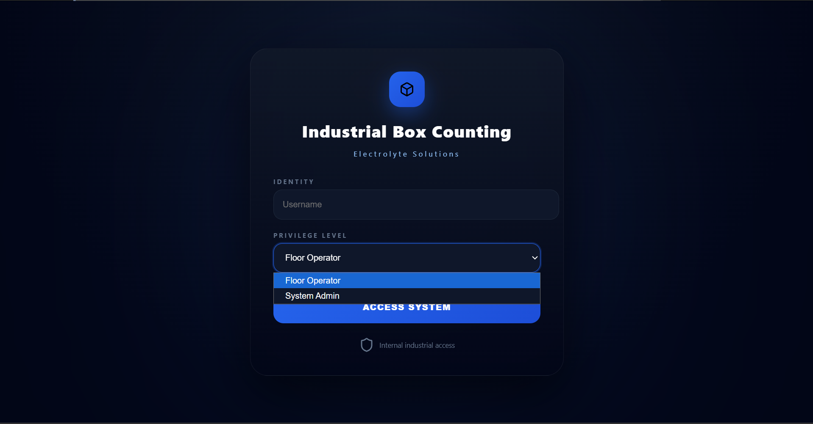
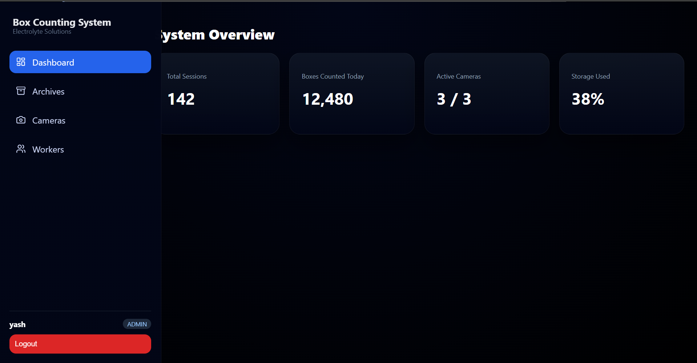
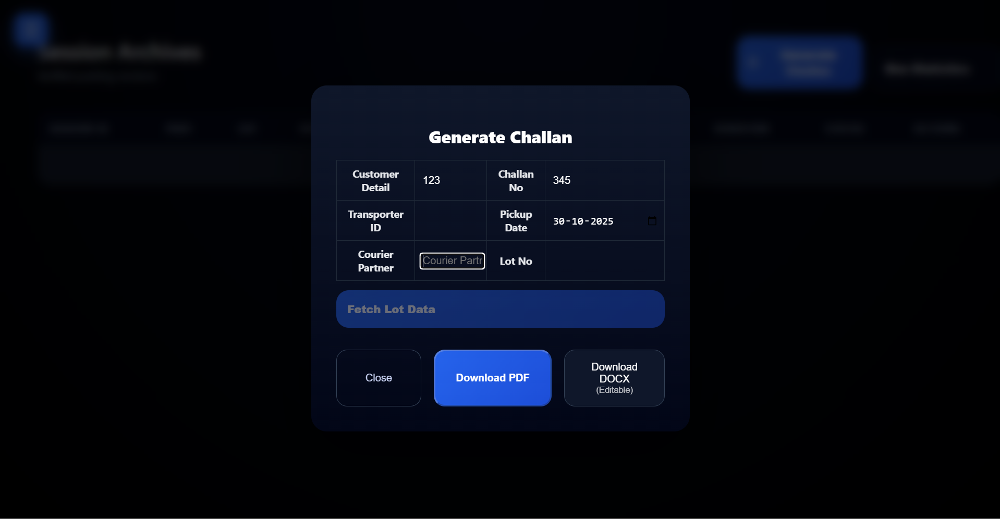

# 📦 Electrolyte Box Detection & Management System

A full-stack web application that **detects and counts electrolyte boxes in real time** using **YOLO** and **OpenCV**. Detection runs on a **Raspberry Pi with a Hailo AI accelerator**, and the results are managed through a web dashboard with session tracking, statistics, challan generation and role-based access control.

---

## 🎥 Demo Video

[(screenshots/dashboard.png)(screenshots/archives page.png)(screenshots/generate challan.png)]((https://youtu.be/6ic29q6Jy90))

> Click the image above to watch the full demo.

---

## ✨ Features

- Real-time box **detection and counting** using YOLO + OpenCV
- Edge inference on **Raspberry Pi + Hailo accelerator** for fast, low-power processing
- Live video stream with detections overlaid
- **Session tracking**: start, stop and review counting sessions
- **Statistics dashboard** for counts and history
- Automatic **challan (delivery receipt)** generation
- **Role-based access control** with secure login
- SQLite database for persistent storage
- Automatic cleanup of sessions older than 3 months

---

## 🧠 How It Works

1. A camera feeds video frames to the **Raspberry Pi**.
2. The YOLO model runs on the **Hailo accelerator** and detects boxes in each frame.
3. **OpenCV** processes the detections and counts the boxes.
4. The **Node.js / Express backend** stores the counts against a session in **SQLite**.
5. The **React frontend** shows the live feed, statistics, session history and challans.

```
Camera → Raspberry Pi + Hailo (YOLO detection) → OpenCV counting
                         ↓
              Flask detection server (:8000)
                         ↓
        Node.js / Express backend (:5000) ↔ SQLite
                         ↓
                React frontend (dashboard)
```

---

## 🛠️ Tech Stack

| Layer | Technology |
|-------|------------|
| Frontend | React |
| Backend | Node.js, Express |
| Database | SQLite (better-sqlite3) |
| Detection server | Python, Flask |
| Computer vision | YOLO, OpenCV |
| Edge hardware | Raspberry Pi, Hailo AI accelerator |

---

## 🖼️ Screenshots

### Login


### Dashboard / Statistics



### Challan


---

## 📁 Project Structure

```
├── backend/            # Express API, SQLite database, authentication
├── box-counting-app/   # React frontend
├── Steaming/           # Video streaming and detection module
└── screenshots/        # Project screenshots
```

---

## ⚙️ Installation

### Prerequisites

- **Node.js 20 or higher**
- **Python 3.x** with the detection dependencies (OpenCV, Flask, etc.)
- **Git**
- For on-device detection: Raspberry Pi with a Hailo accelerator and the Hailo software installed

### 1. Clone the repository

```bash
git clone https://github.com/YashShengale/Electrolyte_Box_Detection_-_Management_System.git
cd Electrolyte_Box_Detection_-_Management_System
```

### 2. Start the backend

```bash
cd backend
npm install
npm start
```

The Node API runs on **port 5000** and starts the Flask detection server on **port 8000**.

### 3. Start the frontend

Open a second terminal:

```bash
cd box-counting-app
npm install
npm start
```

Open the URL shown in the terminal (usually `http://localhost:3000`) and log in.

---

## 🚀 Usage

1. Log in with your account.
2. Start a new counting session.
3. Point the camera at the boxes and watch the live count.
4. Stop the session to save the result.
5. View statistics, past sessions and generate the challan.

---

## 🔮 Future Improvements

- Multi-camera support
- Cloud deployment and remote monitoring
- Support for more box types and sizes
- Export reports as PDF / Excel

---

## 👤 Author

**Yash Shengale**
GitHub: [@YashShengale](https://github.com/YashShengale)